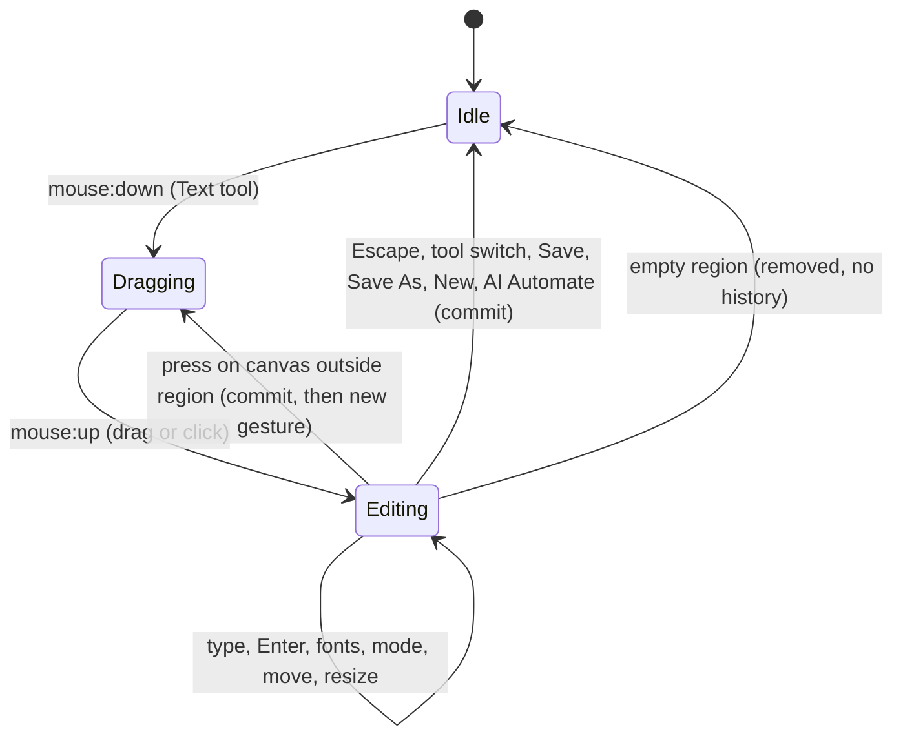

# Paint Text Tool Win98 Behavior Bugfix Design

## Overview

The user asked for the Paint Text tool to work like the Text tool in Windows 98 Paint and did not ask for a literal textbox. The current tool is a literal textbox. A click opens a single-line `<input type="text">` over the canvas, Enter commits, and the commit adds one Fabric `IText` vector object (16px sans-serif, foreground color). Windows 98 Paint works differently: the user drags a dotted region with resize handles, types into it with wrapping and multiple lines, styles it from a Fonts toolbar, picks opaque or transparent background mode, and the text becomes part of the bitmap when the region is committed.

The fix replaces the input overlay with a text region that follows the Windows 98 model. The main parts are:

- **Region**: a drag (or click) on the canvas defines a dotted-border region with 8 resize handles. The region can be moved by its border and resized by its handles.
- **Editor**: a multi-line `<textarea>` inside the region, styled with no form-input look, wrapping at the region's right edge.
- **Fonts toolbar**: font family, size, Bold, Italic, Underline, shown while a region is open.
- **Colors and mode**: a new background (secondary) color, set by right-clicking a palette swatch, and an Opaque/Transparent mode in the Text tool options.
- **Commit to raster**: committing draws the text into the canvas bitmap as pixels and records exactly one history step. No `IText` object is created.
- **Commit triggers**: click outside the region, tool switch, Escape, Save, Save As, New, and AI Automate. None of them depend on input blur.

Three items from the requirements phase are still open and are repeated in [Open Items](#open-items-from-the-requirements-phase) at the end. In short: Escape is assumed to commit (bugfix.md 2.8), the background color is a new addition because Paint has only one color today (2.5), and Paint has no menu bar, so the Fonts toolbar cannot sit behind a View menu (2.4).

## Glossary

- **Bug_Condition (C)**: A Text-tool interaction where the current implementation differs from Windows 98 Paint. It covers drag-defined regions, typing with wrap and Enter, Fonts and mode changes, move and resize, commit, and the commit triggers.
- **Property (P)**: The Windows 98 behavior for those interactions, as written in bugfix.md 2.1 to 2.10 and refined by Properties 3 to 6 below.
- **Preservation**: Behavior outside the Text tool that must stay unchanged: other tools, history, save and load, AI Automate, palette left-click, Ctrl+Z shortcuts, and everything outside Paint (bugfix.md 3.1 to 3.8).
- **Region**: The rectangle, in canvas pixel coordinates, that holds the text being edited. It exists only between the end of the defining gesture and the commit.
- **Commit**: Drawing the region's text onto the canvas bitmap, closing the region, and recording one history entry.
- **Foreground color (fg)**: The existing `color` state in `src/apps/paint/Paint.tsx`. Text glyphs use it.
- **Background color (bg)**: New `bgColor` state, default `#ffffff`. Only an Opaque commit uses it.
- **Mode**: `'transparent'` (default) or `'opaque'`. A Text tool option that persists across regions.
- **Flatten**: Render the whole Fabric canvas to a bitmap, draw on it, and replace the canvas content with that one image. `floodFill` in `Paint.tsx` already does this.
- **`Paint`**: The component in `src/apps/paint/Paint.tsx`.
- **`live`**: The ref in `Paint` that holds the latest `tool`, `color`, `size`, `dirty`, `file` for handlers attached once.
- **`commitText` / `textOverlay` / `textValue`**: The current commit callback and overlay state in `Paint.tsx` (around lines 287-290 and 393-424). The fix removes them.
- **`.paint-text-input`**: The CSS class of the current `<input>` (`paint.css`, `Paint.tsx` around lines 694-720). The old e2e spec selects it.
- **`HistoryStack`**: The snapshot undo stack in `src/apps/paint/history.ts`. A snapshot is the Fabric JSON plus the canvas size.

## Bug Details

### Bug Condition

The bug manifests whenever the user works with the Text tool. The tool was built as "click, type one line, press Enter" because the earlier `add-text-button-not-working` spec and the `paint-textbox` task described a textbox. Every Windows 98 behavior in the list below is absent or inverted:

- `mouse:down` is the only Fabric handler with a text branch. It ignores the drag and opens an `<input>` at the press point (1.1, 1.2).
- A single-line `<input>` cannot wrap and Enter is the commit key (1.3).
- There is one `color` state, no font state, and no mode state (1.4, 1.5).
- Nothing in the overlay can be moved or resized (1.6).
- `commitText` trims the value and adds an `IText`, so the text is a vector object (1.7).
- Escape and the tool-switch effect clear the overlay without drawing (1.8).
- The Save, Save As, New, and AI Automate handlers never look at the overlay (1.9).

**Formal Specification:**
```
FUNCTION isBugCondition(input)
  INPUT: input of type TextToolInput
         { tool, event, regionOpen, pendingText }
  OUTPUT: boolean

  RETURN input.tool = 'text'
         AND (
              (input.event IS PointerDragOnCanvas AND dragLength(input.event) > 0)    // 1.1
           OR (input.event IS PointerClickOnCanvas)                                    // 1.2
           OR (input.event IS Typing AND (overflowsRegionWidth(input) OR hasEnter(input)))  // 1.3
           OR (input.event IS FontChange OR input.event IS ModeChange
               OR input.event IS BackgroundColorPick)                                  // 1.4, 1.5
           OR (input.event IS MoveRegion OR input.event IS ResizeRegion)               // 1.6
           OR (input.event IS Commit)                                                  // 1.7
           OR (input.regionOpen AND (input.event IS Escape OR input.event IS ToolSwitch))   // 1.8
           OR (input.regionOpen AND input.event IS (Save OR SaveAs OR New OR AIAutomate))   // 1.9
         )
END FUNCTION
```

### Examples

- Select Text and drag from (50, 40) to (250, 120). Expected: a 200 x 80 dotted region with 8 handles, open for typing. Actual: an 80px-wide `<input>` at (50, 40), and the drag rectangle is ignored.
- Type "Hello world, this is a long line" into a 100px-wide region. Expected: the text wraps inside the region. Actual: the `<input>` scrolls sideways.
- Type "one", press Enter, type "two". Expected: two lines. Actual: Enter commits "one" and the "two" starts a new input only if the user clicks again.
- Open a region, choose Bold and Italic in the Fonts toolbar. Expected: the text restyles and commits in bold italic. Actual: there is no Fonts toolbar, and the text is 16px regular.
- Fill an area red, set the mode to Opaque, right-click a blue swatch, commit text over the red area. Expected: the whole region becomes blue with the glyphs on top. Actual: no mode or background color exists.
- Type "Hi", then press Escape or click the Pencil tool. Expected: "Hi" is drawn into the bitmap (Escape per the open assumption). Actual: "Hi" is discarded.
- Type "Hi", then click Save As... Expected: "Hi" is committed first and is in the saved PNG. Actual: the overlay blurs, and the result depends on focus order.
- Edge: click the canvas and press Escape without typing. Expected: the region disappears and the canvas and history are unchanged.
- Edge: drag beyond the canvas edge. Expected: the region is clamped to the canvas.

## Expected Behavior

### Preservation Requirements

**Unchanged Behaviors:**
- Pencil, brush, eraser, line, rectangle, ellipse, and fill draw, fill, and record history as before (3.1).
- Undo and Redo, from the toolbar or Ctrl+Z, Ctrl+Y, Ctrl+Shift+Z, go through the existing `HistoryStack`, and a committed text is one step (3.2).
- Clicking the Text button makes Text active with `aria-pressed="true"` and the text cursor. Other tool buttons behave as before (3.3).
- Save, Save As, and reopening export and load PNG as before, including committed text (3.4).
- AI Automate shows its dialog and loading overlay and replaces the canvas with the result as before (3.5).
- A left-click on a palette swatch sets the foreground color for the drawing tools, and brush size works as before (3.6).
- With no region open, the Paint root still receives the Ctrl+Z and Ctrl+Y shortcuts (3.7).
- The Paint window, other apps, and the desktop are unchanged (3.8).

**Scope:**
All inputs where the Text tool is not involved are unaffected. This includes:
- Pointer and keyboard input with any other tool.
- Save, Save As, New, and AI Automate when no region is open. The added commit call returns at once when there is nothing to commit.
- Undo and Redo with no region open.

Two non-obvious preservation points follow from the design:

- The eraser still paints white (TD-2). The new background color applies only to an Opaque text commit, so a non-white background color does not change the eraser. This differs from Windows 98 and is listed in the open items.
- Flattening on commit uses the same replace-with-one-image approach as `floodFill`, so earlier vector strokes become bitmap at that moment, as they already do after a fill. Undo restores the pre-commit snapshot.

## Hypothesized Root Cause

Based on the bug description and the code, the most likely causes are:

1. **Wrong tool model (primary)**: The tool was specified and built as a textbox: one `<input>`, Enter to commit, blur to commit. Windows 98 Paint models text as a region that is edited and then rasterized. Every defect in 1.1 to 1.9 follows from that model. This is confirmed by reading `Paint.tsx` and the `paint-textbox` review, which describes "an absolutely positioned input" and an `IText` commit.

2. **Single-line control**: `<input type="text">` has no wrapping and no multi-line editing, so 1.3 cannot be met without replacing it with a `<textarea>` (or contenteditable).

3. **Vector commit**: `commitText` creates an `IText` with `selectable: false, evented: false` and calls `record()`. The text stays a Fabric object in the history JSON and the PNG export. It is never part of a bitmap, and `trim()` removes the user's own whitespace (1.7).

4. **Focus-driven commit logic**: Commit and cancel depend on `onBlur` and `relatedTarget`. The `paint-textbox` review found this fragile on browsers that do not focus buttons on click. A Fonts toolbar and palette that take focus would make it worse, because focus would leave the editor during normal use. The new design must not use blur as a trigger.

5. **Missing state and UI**: There is no `bgColor`, mode, font state, Fonts toolbar, or Text tool options area, and the palette handles only left-click.

6. **Coordinate offset (side finding, fixed as a by-product)**: The overlay is placed with `offsetX - scrollLeft` inside `.paint-surface`, which has `padding: 2px`. The canvas does not sit at the surface origin. The `add-text-button-not-working` design noted this and left it. The new region is mounted inside the Fabric canvas wrapper, so it uses canvas coordinates directly and the problem disappears.

Not a cause: tool activation and Fabric `mouse:down` dispatch. The earlier analysis found them correct, and requirement 3.3 keeps them.

## Correctness Properties

Property 1: Bug Condition - The Text tool behaves like Windows 98 Paint

_For any_ input where the bug condition holds (isBugCondition returns true), the fixed `Paint` SHALL produce the Windows 98 behavior defined by Properties 3, 4, 5, and 6, which together cover region definition, editing and styling, commit to raster, and commit triggers.

```
FUNCTION expectedBehavior(result)
  INPUT: result of type PaintState after the input is handled
  OUTPUT: boolean

  RETURN regionDefinedAndEditable(result)          // Property 3
         AND editingAndStyleCorrect(result)        // Property 4
         AND commitIsSingleRasterStep(result)      // Property 5
         AND commitTriggersCommitFirst(result)     // Property 6
END FUNCTION
```

**Validates: Requirements 2.1, 2.2, 2.3, 2.4, 2.5, 2.6, 2.7, 2.8, 2.9, 2.10**

Property 2: Preservation - Behavior outside the Text tool is unchanged

_For any_ input where the bug condition does NOT hold (other tools, history, save and load, AI Automate with no open region, palette left-click, Ctrl+Z shortcuts, other apps), the fixed `Paint` SHALL produce the same result as the original, preserving drawing, history, persistence, AI image replacement, color selection, and keyboard shortcuts.

**Validates: Requirements 3.1, 3.2, 3.3, 3.4, 3.5, 3.6, 3.7, 3.8**

Property 3: Region definition, move, and resize

_For any_ drag or click with the Text tool on the canvas, the opened region SHALL be the drag rectangle (normalized so width and height are positive) clamped to the canvas, or the default size anchored at the click point when the drag is shorter than the drag threshold. The region SHALL be drawn with a dotted border and 8 handles and no form-input styling. _For any_ move or resize gesture on an open region, the resulting rectangle SHALL lie inside the canvas and SHALL be at least the minimum size, and the text SHALL stay editable.

**Validates: Requirements 2.1, 2.2, 2.6**

Property 4: Editing, wrapping, fonts, colors, and mode

_For any_ text typed into an open region, the editor SHALL insert it directly, SHALL start a new line on Enter, and SHALL wrap at the region's right edge, rewrapping when the region is resized. _For any_ Fonts toolbar change (family, size, Bold, Italic, Underline), all the text in the region SHALL be restyled and the commit SHALL use that style. The text SHALL use the foreground color. The mode SHALL default to Transparent and the background color to white. Right-click on a swatch SHALL set only the background color, and left-click SHALL set only the foreground color.

**Validates: Requirements 2.3, 2.4, 2.5, 2.6**

Property 5: Commit is one raster history step

_For any_ region with at least one character, committing SHALL draw every line of the text onto the bitmap in the region's font, size, style, and colors with the user's spaces and blank lines kept. In Opaque mode it SHALL fill the whole region with the background color first. In Transparent mode every pixel inside the region without a glyph SHALL equal its value before the commit. Pixels outside the region SHALL be unchanged. The canvas SHALL contain no text object and no editable region afterward, and `HistoryStack.undoDepth` SHALL increase by exactly 1. _For any_ region with no characters, committing SHALL remove it and leave the pixels and the history unchanged.

**Validates: Requirements 2.7, 2.8**

Property 6: Every commit trigger commits first

_For any_ open region and any trigger in {click outside the region (canvas, toolbox, toolbar, surface background), tool switch, Escape, Save, Save As, New, AI Automate}, the region SHALL be committed per Property 5 before the trigger's own action runs, so a saved or exported image includes the text. A click or drag on the canvas that commits an open region SHALL also start a new region in the same gesture. Clicks inside the region, in the Fonts toolbar, in the Text tool options, and on the palette SHALL NOT commit.

**Validates: Requirements 2.8, 2.9, 2.10**

## Fix Implementation

### Changes Required

Assuming the root cause analysis is correct, the fix replaces the overlay `<input>` and `IText` commit with a region model, a `<textarea>` editor, and a synchronous raster commit.

**New files** (all in `src/apps/paint/`):

- `textRegion.ts`: pure geometry and constants. No DOM, no Fabric.
- `textRaster.ts`: line measurement from the editor and the raster commit.
- `TextRegion.tsx`: the region overlay (dotted border, handles, `<textarea>`).
- `FontsToolbar.tsx`: the Fonts toolbar.

**File**: `src/apps/paint/textRegion.ts`

**Functions**: `normalizeRect`, `clampRect`, `moveRect`, `resizeRect`, `regionFromGesture`, `fontCss`, `ptToPx`

**Specific Changes**:
1. **Types and constants**: `Rect {x, y, w, h}`, `HandleId` (`n ne e se s sw w nw`), `TextStyle {family, sizePt, bold, italic, underline}`, `TextMode`. Constants `DRAG_THRESHOLD = 3`, `DEFAULT_REGION = {w: 100, h: 40}`, `MIN_REGION = {w: 20, h: 20}`. These values are design choices to confirm in review, not Windows 98 facts.
2. **Geometry**: `regionFromGesture(p0, p1, canvasSize)` returns the clamped normalized rectangle for a drag, or the default-size rectangle anchored at `p0` for a click, shifted to stay inside the canvas. `moveRect` and `resizeRect(rect, handle, dx, dy, bounds)` keep the result inside `bounds` and at least `MIN_REGION`. Resizing from a west or north handle keeps the opposite (east or south) edge fixed.
3. **Font helpers**: `ptToPx(pt) = pt * 4 / 3`. The default style is Arial 12 pt, which is 16 px and matches the size users see today. `fontCss(style)` builds the CSS font shorthand. `lineHeightPx(style)` returns one value, and both the editor CSS and the raster use it.
4. **Font list and sizes**: a fixed list of web-safe families, each with a generic fallback (Arial, Courier New, Times New Roman, Verdana, Tahoma, Comic Sans MS), and sizes 8, 9, 10, 11, 12, 14, 16, 18, 20, 22, 24, 26, 28, 36, 48, 72 pt. A browser cannot list installed fonts reliably, so the list is fixed.

**File**: `src/apps/paint/textRaster.ts`

**Functions**: `readWrappedLines(textarea)`, `rasterizeText(ctx, args)`, `commitTextRegion(canvas, args)`

**Specific Changes**:
1. **`readWrappedLines`**: builds a hidden mirror `<div>` with the textarea's computed font, content width, `white-space: pre-wrap`, and `overflow-wrap: break-word`, then groups characters by their `Range` client-rect top. It returns `string[]`. This reads the browser's own wrapping, so the committed lines match what the user saw. jsdom has no layout, so this function is covered by Playwright only.
2. **`rasterizeText(ctx, {rect, lines, style, fg, bg, mode, scale})`**: pure given a 2D context. It saves the context, scales by `scale`, clips to `rect`, fills `rect` with `bg` when `mode = 'opaque'`, sets `ctx.font` from `fontCss`, draws each line at `rect.y + i * lineHeight + halfLeading + ascent` with `fillStyle = fg` (ascent from `measureText().fontBoundingBoxAscent`, with a 0.8 em fallback), and draws an underline bar under each line when `underline` is set. It never trims.
3. **`commitTextRegion`**: the synchronous commit. It calls `canvas.toCanvasElement(scale)` where `scale = window.devicePixelRatio` (Fabric 6.9.1 provides it, and it includes the canvas background), runs `rasterizeText` on that element's 2D context, then does `canvas.clear()`, restores `backgroundColor = '#ffffff'`, and adds one `new FabricImage(element, {left: 0, top: 0, scaleX: 1/scale, scaleY: 1/scale, selectable: false, evented: false})`. `FabricImage` serializes a canvas element through `toDataURL`, so the existing snapshot and `loadFromJSON` path works. The function does not call `record()`. The caller does, once.
4. **Why synchronous**: `FabricImage.fromURL` and `floodFill` are asynchronous. A synchronous commit lets Save, New, and AI Automate commit and continue in the same tick, with no race between a pending commit and an export.
5. **Why the device pixel ratio**: the canvas is created with `enableRetinaScaling: true`. A 1x flatten would blur existing strokes on high-DPI screens, which regresses the `paint-pencil-quality-degradation` fix.

**File**: `src/apps/paint/TextRegion.tsx`

**Component**: `TextRegion`

**Specific Changes**:
1. **Mount point**: rendered with `createPortal` into the Fabric wrapper element (`canvas.wrapperEl`, which is `position: relative` and sized to the canvas), so the region uses canvas pixel coordinates directly. This removes the `offsetX - scrollLeft` and 2px padding offset.
2. **Structure**: a wrapper `div.paint-text-region` (`data-testid="text-region"`) at `rect`, a transparent move strip along each edge (`data-move`), 8 handle elements (`data-handle="nw"` and so on), and the `<textarea>`. The wrapper draws `1px dotted` with no input chrome. The textarea has no border, `resize: none`, `overflow: hidden`, `white-space: pre-wrap`, `overflow-wrap: break-word`, `padding: 0`, the style's font and line height, `color: fg`, and `background: bg` in Opaque mode or `transparent` otherwise.
3. **Gestures**: move strips and handles use pointer capture. They call `preventDefault` on pointerdown so the textarea keeps focus. They call the pure `moveRect` and `resizeRect`.
4. **Growth**: on input and on width change, the region height becomes `max(rect.h, textarea.scrollHeight)`, capped at the canvas bottom. The region grows so no typed line is lost. Text past the canvas bottom is clipped at commit, like any drawing.
5. **Keys**: Enter inserts a newline (the default). Escape calls the commit-or-discard handler chosen by one constant, `ESCAPE_ACTION = 'commit'`, so reversing the open assumption is a one-line change.
6. **Focus**: focuses the textarea with `preventScroll: true` when the region opens, and after any Fonts toolbar change.

**File**: `src/apps/paint/FontsToolbar.tsx`

**Component**: `FontsToolbar`

**Specific Changes**:
1. A `role="toolbar"` element labelled "Fonts" with a family `<select>` (label "Font"), a size `<select>` (label "Font size"), and Bold, Italic, Underline buttons with `aria-pressed`.
2. It renders only while a region is open, as a floating panel positioned absolutely inside `.paint` (like `.paint-ai`), so it does not shift the layout under the pointer. Windows 98 also shows the toolbar as a floating panel.
3. Buttons call `preventDefault` on mousedown so the textarea keeps focus. Selects return focus to the textarea after `onChange`.

**File**: `src/apps/paint/Paint.tsx`

**Function**: `Paint` component

**Specific Changes**:
1. **State**: remove `textOverlay`, `textValue`, `textInputRef`, and the `IText` import. Add `bgColor` (default `#ffffff`), `textMode` (default `'transparent'`), `textStyle`, a `regionRef` that is the source of truth for the open region (rect, text) so commit can read it synchronously, and a `bump` or state mirror for rendering.
2. **`commitPending()`**: returns `false` when no region is open or the text is empty (it closes an empty region without touching history). Otherwise it reads the lines through `readWrappedLines`, calls `commitTextRegion` with the current `fg`, `bg`, mode, and style, closes the region, and calls `record()` once. It is idempotent and safe to call from any handler.
3. **Gesture handling in the Fabric `mouse:down`, `mouse:move`, `mouse:up` handlers**: the `text` branch calls `commitPending()`, then records the press point as a text drag. `mouse:move` updates a dotted rubber-band rectangle. `mouse:up` calls `regionFromGesture` and opens the region. A drag shorter than `DRAG_THRESHOLD` opens the default-size region. Because Fabric events fire only for clicks outside the region (the region sits above the upper canvas), this branch is the 2.10 path.
4. **Outside-click commit**: add `onPointerDownCapture` on the `.paint` root. While a region is open, a press outside `.paint-text-region`, `.paint-fonts-toolbar`, `.paint-text-options`, and `.paint-palette` calls `commitPending()`. This covers the toolbox, top toolbar, status bar, and the gray surface beside the canvas. Presses on the canvas itself are handled by item 3. Palette presses do not commit, and a left-click recolors the open text through `color`.
5. **Explicit triggers, not only pointer events**: `selectTool(id)` calls `commitPending()` before `setTool`, which replaces the `[tool]` cancel effect and its `eslint-disable`. `newDrawing`, `save`, the Save As button, the AI Automate button, and `generate` each call `commitPending()` first. `exportPng` also calls it, which is a single choke point that makes any saved or exported image include the text, even from a keyboard-activated button. After `commitPending` marks the drawing dirty, `newDrawing` shows the "Discard unsaved changes" confirmation as it would for any edit.
6. **AI Automate**: `runAutomate` sends only the prompt (`imageActions.generateImageData({prompt, signal})`), and the result replaces the canvas. The commit still matters because it puts the text on the canvas and in history, so Undo after AI Automate can bring it back. Requirement 3.5 says "send the current canvas image". The code does not do that, and the fix does not change it.
7. **Palette and colors**: swatch buttons keep `onClick` for foreground and add `onContextMenu` (with `preventDefault`) to set `bgColor`. Add a `.paint-colors` indicator with a foreground box over a background box (`aria-label="Foreground color: #..."` and `"Background color: #..."`).
8. **Text tool options**: when `tool === 'text'`, render a `.paint-text-options` group under the tool grid with two buttons, "Opaque" and "Transparent", each with `aria-pressed`. Changing the mode while a region is open updates the editor background at once.
9. **Focus guards kept**: the existing surface `onPointerDown` and `onMouseDown` guards (which stop the `.paint` root from stealing focus) stay, retargeted from `.paint-text-input` to `.paint-text-region`, and they also skip root focus while a region is open. The e2e cases from `add-text-button-not-working` stay valid.
10. **Keyboard**: the root `onKeyDown` already ignores Ctrl+Z, Ctrl+Y inside `INPUT` and `TEXTAREA`, so native text undo works inside the region (3.7 still holds with no region open).

**File**: `src/apps/paint/paint.css`

**Specific Changes**: remove `.paint-text-input`. Add `.paint-text-region`, `.paint-text-handle` (5px squares, cursors `nwse-resize`, `ns-resize`, and so on), `.paint-text-move`, `.paint-text-draft` (the rubber band), `.paint-fonts-toolbar`, `.paint-text-options`, and `.paint-colors`.

**File**: `FUNCTIONALITY.md` (Paint section, line 39)

**Specific Changes**: replace the Text tool bullet with the Windows 98 behavior and add bullets for the new controls. Proposed text:
- `Text tool (capital "T" button): drag on the canvas to draw a text region, or click for a default-size one. Type directly into the region; text wraps at the right edge and Enter starts a new line. Drag the border to move the region and drag the handles to resize it. A Fonts toolbar (font, size, Bold, Italic, Underline) appears while a region is open.`
- `Text background: choose Opaque or Transparent in the tool options below the tools. Left-click a palette swatch for the foreground (text) color and right-click for the background color. Opaque fills the region with the background color.`
- `Text becomes part of the picture when you click outside the region, switch tools, press Escape, or use Save, Save As..., New, or AI Automate. Undo removes the whole text in one step.`
- Limitations: the Fonts toolbar always shows with an open region because Paint has no menu bar, the eraser still paints white whatever the background color is, and the font list is fixed.

**File**: `docs/TECH_DEBT.md`

**Specific Changes**: add one row noting that the eraser ignores the new background color (extends TD-2). This is a documentation change only.

### Region lifecycle



## Testing Strategy

### Validation Approach

The testing strategy follows a two-phase approach: first, surface counterexamples that demonstrate the bug on unfixed code, then verify the fix works correctly and preserves existing behavior. Wrapping, focus, pointer gestures, and pixel output need a real browser, so Playwright carries them (Chromium, `deviceScaleFactor` 1 by default). Pure geometry and the raster call sequence run in Vitest. jsdom has no layout and the existing Paint tests stub `getContext` (see `pencilStrokePreservation.test.ts`), so no pixel assertion belongs there.

### Exploratory Bug Condition Checking

**Goal**: Surface counterexamples that demonstrate the bug BEFORE implementing the fix. Confirm or refute the root cause analysis. If we refute, we will need to re-hypothesize.

**Test Plan**: Write the new e2e spec first (below) and run it against the unfixed code. Each case simulates the Windows 98 interaction and asserts the Windows 98 outcome.

**Test Cases**:
1. **Drag defines region**: with Text active, drag (50, 40) to (250, 120) and assert a `[data-testid="text-region"]` of about 200 x 80 with a dotted border and 8 `[data-handle]` elements (will fail on unfixed code)
2. **Multi-line wrap**: type a long sentence into a narrow region and assert the committed pixels form at least 2 text rows (will fail on unfixed code)
3. **Enter is a newline**: type "a", Enter, "b" and assert the region is still open with two lines (will fail on unfixed code)
4. **Fonts toolbar**: assert a "Fonts" toolbar with Bold, Italic, Underline exists while the region is open (will fail on unfixed code)
5. **Opaque fill**: fill the canvas red, choose Opaque, right-click a blue swatch, commit, and assert a region corner pixel is blue (will fail on unfixed code)
6. **Commit is raster, one step**: commit text, press Undo once, and assert the canvas equals the pre-text canvas (may pass partly on unfixed code, because `IText` also records one step, but the earlier cases already fail)
7. **Escape and tool switch commit**: type text and press Escape, or click Pencil, and assert the pixels are drawn (will fail on unfixed code)
8. **Save commits first**: type text, click Save As..., and assert the text pixels are present and the region is gone (will fail on unfixed code)

**Expected Counterexamples**:
- The only text element is `input.paint-text-input` (`tagName === 'INPUT'`), at the press point, 80px wide, with no handles.
- Enter closes the input and draws one line. Escape and tool switch draw nothing. No Fonts toolbar, mode buttons, or background color control exist.
- Possible causes: wrong tool model, single-line control, vector commit, and blur-driven commit, as in the root cause list above. If any case passes on unfixed code, re-check the root cause that predicted it.

### Fix Checking

**Goal**: Verify that for all inputs where the bug condition holds, the fixed function produces the expected behavior.

**Pseudocode:**
```
FOR ALL input WHERE isBugCondition(input) DO
  result := Paint_fixed(input)
  ASSERT expectedBehavior(result)
END FOR
```

### Preservation Checking

**Goal**: Verify that for all inputs where the bug condition does NOT hold, the fixed function produces the same result as the original function.

**Pseudocode:**
```
FOR ALL input WHERE NOT isBugCondition(input) DO
  ASSERT Paint_original(input) = Paint_fixed(input)
END FOR
```

**Testing Approach**: Property-based testing is recommended for preservation checking because:
- It generates many test cases automatically across the input domain
- It catches edge cases that manual unit tests might miss
- It provides strong guarantees that behavior is unchanged for all non-buggy inputs

**Test Plan**: Run the existing suites on unfixed code first and record that they pass, then run them again after the fix: `history.test.ts`, `pencilStrokePreservation.test.ts`, `pencilStrokeCommitBlur.bug.test.ts`, `aiImage.test.ts`, and the e2e specs `paint-persistence`, `paint-ai-generation`, `harness`, `desktop-icon-drag`, `wordpad-*`, `recycle-bin`, `clippy-*`, and `cmd-shared-fs`. `fast-check` is already a dependency and is used for the geometry properties below.

**Test Cases**:
1. **Other tools**: pencil, line, rectangle, ellipse, and fill produce the same pixels and history depth after the fix (3.1)
2. **Undo and Redo**: toolbar buttons and Ctrl+Z, Ctrl+Y, Ctrl+Shift+Z still work with no region open, and with a committed text step in the middle (3.2, 3.7)
3. **Save and reopen**: Save, Save As, and reopen round-trip a PNG, including committed text (3.4)
4. **AI Automate with no region**: the dialog, loading overlay, and replacement behave as before (3.5)
5. **Palette left-click and brush size**: still set the foreground color and drawing size (3.6)
6. **Tool button state**: each tool button toggles `aria-pressed` and the cursor as before (3.3)

### Unit Tests

New file `src/apps/paint/textRegion.test.ts` and `src/apps/paint/textRaster.test.ts`:

- `regionFromGesture`: drag in any direction gives a positive normalized rectangle, a drag below the threshold gives the default size at the anchor, and results are clamped to the canvas
- `moveRect` and `resizeRect`: the result stays inside the bounds and at least `MIN_REGION` for every handle and any delta
- `ptToPx`, `fontCss`, and `lineHeightPx`: Bold, Italic, and size map to the expected CSS values, and the default is 16 px
- `rasterizeText` against a recording fake 2D context: Opaque issues one fill of the region rectangle before any text, Transparent issues none, there is one `fillText` per line, Underline adds one bar per line, the region is clipped, and no line is trimmed
- `commitTextRegion` with the jsdom canvas stub: after the call the Fabric canvas holds exactly one object and no `IText`, and an empty text input is rejected by `commitPending` (no history change)
- The Escape setting: `ESCAPE_ACTION` selects commit or discard

### Property-Based Tests

- Region gestures: for random start and end points, canvas sizes, and handles, the rectangle invariants of Property 3 hold (inside the canvas, at least the minimum size, positive width and height)
- Move then move back, and resize with a zero delta, return the original rectangle
- Rasterization over random text, including empty lines, leading and trailing spaces, and mixed styles: the number of `fillText` calls equals the number of lines, and the text passed to `fillText`, joined, equals the input with only wrap-consumed whitespace removed
- Preservation: for random non-Text tool gestures on a fixed canvas stub, the snapshot JSON is identical before and after the change (compare against a recorded baseline)

### Integration Tests

**Replace `e2e/paint-text-tool.spec.ts`.** The current file encodes the defective behavior (it asserts `.paint-text-input`, Enter to commit, and cancel on Escape and tool switch), so it is rewritten, not patched. Keep the helpers (`countDarkPixels`, `openPaintWithText`) and the `paintCanvas` and `paintUpper` locators. Replace the `textInput` locator with `text-region` and its `textarea`. Mapping from the old cases:

| Old test | Disposition |
|---|---|
| clicking the canvas opens a focused text box that stays open | Keep, retarget to the region textarea. Covers the old focus defects A and B. |
| slow click still leaves the text box open and focused | Keep, retarget. |
| typing and Enter draws text | Replace: type, then click outside to commit. Enter now inserts a newline. |
| clicking inside the open text box keeps it open | Keep, retarget to the textarea. |
| clicking elsewhere on the canvas commits | Keep. Add the assertion that a new region opens at the new point (2.10). |
| Escape cancels and draws nothing | Invert: Escape commits (assumption). Add an empty-region Escape that changes nothing. |
| switching tools cancels | Invert: switching tools commits. |

New cases:

- **Region**: drag creates a region matching the drag within 1 px, dotted border, 8 handles, focused textarea; click creates the default-size region at the click point; a drag past the canvas edge is clamped (2.1, 2.2)
- **Move and resize**: drag the border and the `se` handle; the region follows; after commit the pixels are at the new location and not the old one; narrowing the region increases the row count (2.6)
- **Wrap and Enter**: long text wraps within the region width and Enter makes a new line, checked on committed pixel rows (2.3)
- **Fonts toolbar**: absent with no region, present with one; Bold raises the dark pixel count for the same text, Underline adds a pixel row under the text, a larger size raises the text height, and a different family changes the pixels (2.4)
- **Mode and colors**: Transparent is pressed by default; fill red, commit transparent, and the corner pixel stays red; Opaque with a right-clicked blue swatch gives a blue corner; left-click sets only the foreground, right-click only the background, and the indicators show both; a palette click with a region open does not commit (2.5)
- **Raster, one step**: after commit no region and no input remain; one Undo removes all the text; Redo restores it; the status bar shows the dirty marker (2.7)
- **Empty region**: open and close with no text; the Undo button stays as it was and the pixels are unchanged (2.8)
- **Triggers**: click outside, a click on the toolbox, tool switch, and Escape each commit; Save As... leaves the text in the saved PNG, which the test confirms by reopening it; New with an open region commits and then shows the discard confirmation; AI Automate commits when its dialog opens (2.8, 2.9)
- **Gesture continuity**: pressing elsewhere on the canvas commits the open region and starts a new region on that same press (2.10)

Run the existing e2e specs listed under Preservation Checking in full as the regression pass. After the new spec passes, update `FUNCTIONALITY.md` as described above and record the run in `docs/TEST_RESULTS.md` through the project's `scripts/record-results.ts`.

## Open Items From the Requirements Phase

These remain open. The design isolates each one so a review decision is cheap to apply.

1. **Escape behavior (bugfix.md 2.8)**: the requirement assumes Windows 98 Paint commits on Escape. This has not been confirmed. The design follows the assumption, and `ESCAPE_ACTION` in `TextRegion.tsx` switches between commit and discard. The e2e Escape cases are named "assumption" so a change updates one test group. If the review decides Escape should discard, update 2.8, Property 6, and the FUNCTIONALITY.md line together.
2. **New secondary (background) color (bugfix.md 2.5)**: Paint has had one color. The design adds `bgColor` (default white, right-click to set), scoped to the Opaque text commit. It does not change the eraser, fill, or shapes, so the eraser keeps painting white even if the background color is different. Windows 98 Paint uses the background color for more than text. Confirm that the narrower scope is acceptable, or add a follow-up. The TECH_DEBT row records the mismatch.
3. **No menu bar (bugfix.md 2.4)**: Windows 98 shows the Fonts toolbar through View > Text Toolbar and Opaque/Transparent in the tool options. Paint here has no menu bar, so the design shows the Fonts toolbar automatically while a region is open and cannot offer a way to hide it. Confirm this, or add a View menu as a separate task.

Further decisions made in this design that the review may want to confirm: default region 100 x 40, minimum 20 x 20, drag threshold 3 px, region growth instead of clipping, palette clicks that recolor without committing, whitespace-only text counts as non-empty and commits as typed, toolbar Undo and Redo count as outside clicks (commit, then undo), and the default font Arial 12 pt.
